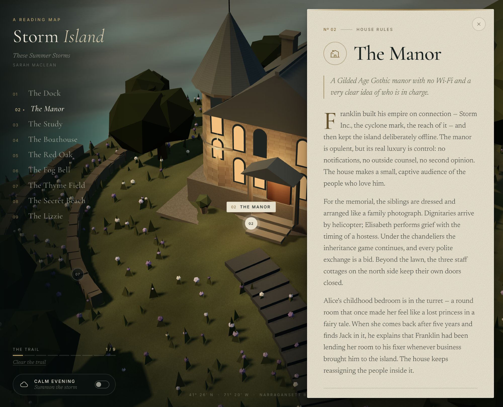

## A map for the book club

Some novels give you a house. *These Summer Storms* gives you an island — sixty-three private acres in Narragansett Bay, reachable only by boat or helicopter, with a Gothic manor on the hill and a storm coming in from the Atlantic.

For a book club, that setting is half the conversation. The island is not just where the Storms gather; it is the reason they cannot leave each other's company. I wanted to make that feeling navigable, so I built a small isometric 3D map of the place: a diorama you can orbit, nine reading stops you can open, and a summer storm you can invite in.

## The island, as a place you can walk

The scene is a hand-built, low-poly interpretation of the novel's setting. The manor sits on a flattened hill above the slate steps. Alice's round turret bedroom rises at the front of the house. The weathered cedar boathouse stands on piles over the water on the west shore, and three staff cottages keep their own lights on along the north lawn.

Around them are the details the book keeps returning to: Franklin's red oak, the antique fog bell by the path, the wild thyme and old stone walls, the sandy secret cove, and *The Lizzie* sailing offshore with her sails full and her wake trailing behind her.

The 3D scenery is not a screenshot or a video. It is a small Three.js world with procedural terrain, a custom water shader, instanced wildflowers, drifting gulls, and a working weather system. Click a numbered marker, or choose a place from the rail, and the camera glides over to it.

## Nine stops, eighteen questions

Each stop opens a paper reading panel with a short essay, a pull quote, a list of motifs, and two discussion questions. The questions are written for a book club circle, not a literature exam:

- The dock, and what a place with no road does to a family.
- The manor, the staff cottages, and Alice's turret room.
- The study, the vault, and the letter hidden behind a painting.
- The boathouse, the cut mooring lines, and the one honest room on the island.
- The red oak, the fog bell, the thyme field, the secret beach, and *The Lizzie*.

A trail at the bottom of the rail keeps track of which places you have visited, so you can work through the island in order or wander.

## Weather is a character

Franklin Storm built a company around connection and then kept the island deliberately offline. The weather does the rest. In calm mode the island sits under a hazy summer evening; flip the weather switch and the sea gets up, rain crosses the view, the house lights burn warmer, and lightning occasionally turns the whole scene white.

It is the same landscape either way. That felt like the right metaphor for the novel.

## The small technical print

- **Three.js** renders the scene: a stylized heightfield island, low-poly buildings, extruded boat hulls, instanced vegetation, and a 3D rain field.
- **Custom GLSL shaders** handle the water, the sky gradient, and the distance fog. The water gets choppier and the horizon closes in when the storm arrives.
- **Procedural placement** keeps the wild thyme, shoreline boulders, and trees from looking stamped on.
- **Astro** serves the whole thing as a standalone route at `/fun/these-summer-storms`, with no site header or footer — the page is meant to feel like stepping onto the island.
- The app itself is plain HTML, CSS, and JavaScript around a locally vendored Three.js build, so the experience stays fast and does not depend on a CDN.

## A note on the fan project

This is a fan-made companion to *These Summer Storms* by Sarah MacLean. It is not affiliated with the author or the publisher. The map contains spoilers for the whole novel, which is probably what you want if you are using it for a book club — but worth knowing before you step ashore.

**[Visit Storm Island →](https://smiling.dev/fun/these-summer-storms/)**
